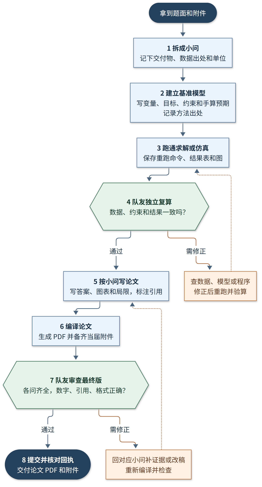

# 三人新手队从入门到完赛

先练到三个人能一起做完一道小问，再扩大到整题。每道小问至少留下一个说得清的答案、一条可复跑的命令或计算步骤，以及一项队友能够独立核对的证据。

[从读题到终审的三人工作流](end-to-end.md)列出每个阶段建模手、编程手和论文手的具体交付。[宇树机器人赛题复盘](robotics-case.md)展示如何在一题的四问里实际使用。

参加本次英文赛项的小组可按 [2026 亚太赛四天参赛计划](apmcm-2026.md) 分工和交接。

[查看从赛题到可提交论文的路线图](../figures/first-contest-mindmap.md)

## 三人第一次合练如何过关

按[三人工作流与验收](end-to-end.md)选择当前阶段。先让队员独立提出判断，再按训练目标给一条提示。

| 练习 | 队员怎样做 | 过关证据 |
| --- | --- | --- |
| 同一小时手算 | 建模手给出硬约束，编程手手算一个通过和一个单错方案，论文手用一句话说明检查结论 | 三个人都能说明失败的是哪条约束 |
| 换电脑复跑 | 一人发原始输入和命令，另一人从空输出目录重跑，第三人核对图表中的数字 | 产物中能回查同一个数字和单位 |
| 中途换角色 | 接手人只看 CASE 和相关文件，找到当前模型决定及待完成的一项工作 | 能说出下一步，且能独立核对上游结果 |
| 换一组数据 | 先写预期结果和边界条件，再换输入比较。必要时记录哪个结论受新输入影响 | 能把问题定位到具体数据行、限制或结果版本 |
| 模拟提交 | 从源码包空目录重编，分别核对论文、附件和披露，再模拟交接上传 | 另一个队员可按文件清单逐项复核 |

记录首个卡点、消耗时间和证据，下轮交换一项复核工作。 [交接模板](../templates/CASE.md) · [三人训练路线](training-drill.md) · [终稿复核](final-delivery.md)

## 第一次合练用这个小例子

1. **建模手**先用 **95 MW** 的小时写出总量平衡和两台机组的出力上限，手算 **80 + 15 MW** 为什么可行。
2. **编程手**跑出这小时的费用 **500**，然后请队友检查 **85 + 10 MW**，指出总量相同但 A 机组超过 **80 MW** 上限。
3. **论文手**写一句结论，交代 95 MW 的需求、方案与费用。把数字标到结果表的对应行，交给另一位队友复算。
4. 把三个小时的需求都提高 **10 MW**。三人先预测方向和哪台机组会多发，再重跑核对总费用 **1120**。最后换成没练过的往年题，先做一问，再做整题限时模拟。[合成题与可复跑命令](../examples/dispatch/README.md)

## 每个人下一步可以练什么

| 岗位 | 入门 | 独立 | 进阶 |
| --- | --- | --- | --- |
| 建模手 | 能讲清变量、单位和约束 | 在新题上独立选基准并写预期 | 用数据和对照解释什么时候值得换模型 |
| 编程手 | 会改输入、重跑并核对结果 | 独立检查原始数据并写边界样例 | 用手算、枚举或另一种实现验证关键结果 |
| 论文手 | 能解释一张图和一个数字 | 独立写完整的小问并给出证据 | 逐句审查结论强度与外推范围 |

### 正式比赛怎样使用 AI

练习时可以让 AI 示范整套流程，再用新输入独立重做。比赛时先核对当届规则。例如 APMCM 的 AI 使用规定要求参赛队独立完成核心模型构建、算法设计与求解、结果分析，并按要求披露 AI 的使用。队内记录实际使用了什么工具、做了什么、采纳了哪些内容和怎么核查。[APMCM AI 使用规定](https://m.saikr.com/contest/notice_detail/50212)

## 在 Codex 里开始合练

> 用 `$mcm-team-drill` 带我们三个人做第一次合练。我们都是零基础，请用合成调度题的一个小时，分别给建模手、编程手和论文手派任务，等我们交接后再核对。

> 我们的试题和附件在 `cases/我的题/inputs/`，想限时练第一问。用 `$mcm-team-drill` 帮我们确定分工和验收标准，结束后用 `$mcm-training-review` 找出一个最值得改的交接问题。

队员已经动手后，把自己的判断和卡点一起发给 AI，并请它等你们验算完再解释。

> 我们认为方案满足总量约束，手算过程在下面。请先指出你最想核对的一个约束或单位，给一个我们能亲手验证的方法，等我们算完再解释。

已有自己的题目与附件时，可以按新题流程开设案例，再用这份指南决定这一轮由谁先交接。[新题协作流程](../.agents/skills/mcm-skill-router/references/new-problem.md)

想看题面、代码、验算表和英文稿怎么一一对应，可以和队友跑一遍[英文短例](../examples/dispatch/README.md)。需要换人接手或只做其中一步时，直接选[可复制的调用指令](codex-prompts.md)。
