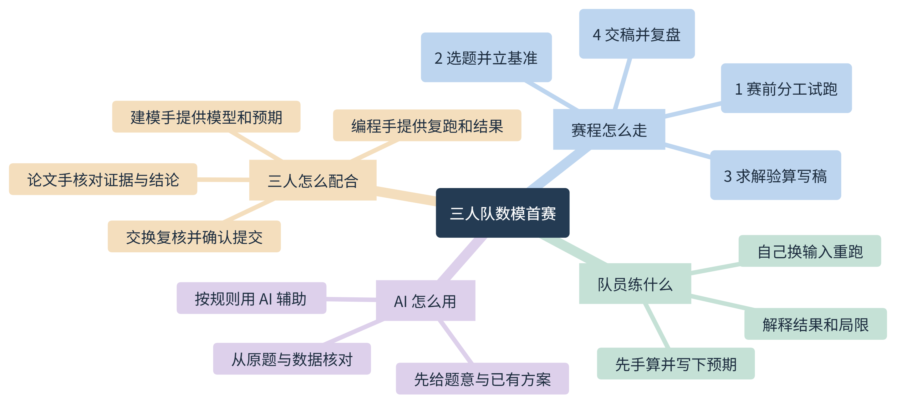

# 三人新手队从入门到完赛

先练到三个人能一起做完一道小问，再扩大到整题。每道小问至少留下一个说得清的答案、一条可复跑的命令或计算步骤，以及一项队友能够独立核对的证据。

[从读题到终审的三人工作流](end-to-end.md)列出每个阶段建模手、编程手和论文手的具体交付。[宇树机器人赛题复盘](robotics-case.md)展示如何在一题的四问里实际使用。

参加本次英文赛项的小组可按 [2026 亚太赛四天参赛计划](apmcm-2026.md) 分工和交接。

[查看从赛题到可提交论文的路线图](../figures/first-contest-mindmap.md)

## 三个岗位怎么分

| 岗位 | 从开局做什么 | 交给队友什么 | 做到什么算通过 |
| --- | --- | --- | --- |
| **建模手** | 读题，逐问写清要交什么。把题面条件变成变量、目标、约束和单位。先定能手算的基准，再决定值得改哪一处。 | 一页模型说明，包含题面出处、关键假设、输入输出和一个手算样例。 | 编程手能按这页实现，论文手能据此解释做法，三人能指出哪些假设会影响结论。 |
| **编程手** | 保留原始附件，查字段、单位、缺失值和重复值。跑通基准，核对程序是否实现了模型。 | 重跑命令、依赖、结果表及用实际结果生成的图。记录测试和求解状态。 | 队友用同一份原始数据能重现关键数值。输入改动或违反约束时，程序能给出对应结果或明确提示。 |
| **论文手** | 从读题阶段就搭逐问结构，记录决策与依据。拿到结果后写方法、结果和局限，并核对图表与来源。 | 论文源稿、图表位置、结论对应的表格行列或图号，以及可用时的编译版 PDF。 | 每个小问有明确回答，摘要、正文与图表使用同一口径，关键数字能回到已核验的结果。 |

三个人一起选题、确定关键假设、审核最后结论。开局指定一人负责看时间和提交，安排另一人交叉检查交稿文件。

## 首赛按这八步走

### 1. 赛前把工具和交接方式练一遍

- **三人一起做**。先定建模、编程、论文主责，再指定交稿负责人和复核人。三个人各自在自己的电脑上打开仓库，试跑一道小问，并约好共享原始附件、结果表和论文的方式。
- **用 AI 陪练**。让 `$mcm-team-drill` 一次只发一个任务。队员先写判断或尝试，再看提示。第一轮直接用下文的调度例题。
- **过关**。每人知道自己的下一步，其中一位能用队友给的命令在自己的电脑上跑出同一个数字。

### 2. 开赛后各自读题，再一起定题

- **三人一起做**。各自读题，写下每问要交什么、有哪些数据、哪一步风险最大。建模手提出一个简单解法，编程手确认附件能打开，论文手核对交付项和截止时间。比较第一问是否能验算、后续是否有数据支撑，再由全队决定选题。
- **用 AI 辅助读题**。请它解释术语、整理你们已记录的题面要求，或指出哪里可能漏读。组员自己翻回原文和附件核对每个决定。
- **过关**。在 `CASE.md` 给每问写一行，包含交付物、输入来源、主责和复核人。定好基准结果、合稿和上传的队内检查时间。

需要补背景、数据或方法时，先记清这份来源要支持哪句话，再查原始发布页或原文。[参考文献指南](references-guide.md)

### 3. 先定一个能验算的基准模型

- **建模手先写**。列出变量、单位、目标和约束，选一个最简单、能回答小问且能核对的办法。写一个手算预期。编程手确认字段与公式能对应，论文手记录每个关键假设的理由。
- **用 AI 查漏**。赛前可以让 AI 示范候选方法。队员先解释自己为什么选当前办法，再请 AI 检查术语、符号或维度。正式参赛时，按当届规则确定辅助范围。
- **过关**。换一个队员用自己的话解释这份模型说明，并指出哪条假设改变后最可能影响结果。说明写清后交给编程手。

### 4. 从原始附件跑出第一版结果

- **编程手先做**。核对字段、单位、缺失值和重复值，用手算样例跑通程序。保留原始附件、复跑命令、结果表和求解状态。论文手同步写逐问结构，建模手核对程序实现的约束。
- **用 AI 辅助实现**。先告诉它现有模型、具体卡点和预期结果，再按赛前或赛中的允许范围使用。练习时可请它解释报错、给小段示例，随后由队员改一个输入并自行复跑。
- **过关**。另一位队友能从原始数据重跑，至少复算一个关键数。结果表里每个量都有单位，论文手知道该去哪里取数。

### 5. 主动找一个会暴露错误的输入

- **三人各做一项**。建模手定一个合理边界或改动方向，编程手测试正常样例、单错反例或换输入，论文手核对哪些结论会跟着变。先分别写下预期，再看运行结果。
- **用 AI 辅助验错**。让它给可能的检查点或指出矛盾，队员从原题判断该反例是否有效。随机结果要结合实际覆盖范围来解释。
- **过关**。能指出错在具体约束、数据行或图表字段。若时间足够，再做一个有明确理由的方案改进，用同一输入和同一指标与基准对照。

### 6. 把结果交接成图表和论文

- **论文手汇总**。每小问先给答案，再说明计算依据、单位和适用范围。编程手从同一份结果表出图，建模手判断文字里的结论是否超出了验证范围。
- **用 AI 辅助表达**。按赛事允许范围，让它检查表述、润色已有草稿或辅助排版。队友逐项核对引用、图表与正文中的数字。
- **过关**。摘要中的关键数值都能追到结果表的行列或图号。改模型或改数据后，重建受影响的表、图和正文，再合入主稿。

### 7. 从干净目录复跑一次，再提交

- **三人分工复核**。一人用最终输入复跑，另一人检查 PDF 能打开、逐问齐全、页码和图表正常，交稿负责人按照当届要求核对命名、匿名、附件和时间。
- **用 AI 辅助整理**。在赛事允许范围内，根据真实文件和使用记录生成核对清单；上传和检查回执由队员负责。
- **过关**。开赛前用模拟赛演练一次完整提交。正式比赛由交稿负责人完成上传，另一位队友确认提交回执。

### 8. 复盘时交换任务，练到能独立接手

- **记一处卡点**。记录实际用时、最先卡住的步骤、当时看过的证据和下一轮要改的动作。下一轮换数据或换题，检验同类问题能否由队员自行处理。
- **交换一项复核工作**。让建模手重跑程序，编程手解释一条约束，论文手从账本复算一个数字。
- **逐步减少提示**。第一轮先想再看 AI 示范，第二轮写出方案后请 AI 挑错，第三轮让队员独立完成并交叉复核。AI 可根据你们留下的证据给反馈。

交接时说清**哪一问、用哪份输入、怎么重跑、证据在哪、还有什么待确认**。全队共用一份 `CASE.md` 记录当前版本与验收证据。[交接记录模板](../templates/CASE.md)

## 第一次合练用这个小例子

1. **建模手**先用 **95 MW** 的小时写出总量平衡和两台机组的出力上限，手算 **80 + 15 MW** 为什么可行。
2. **编程手**跑出这小时的费用 **500**，然后请队友检查 **85 + 10 MW**，指出总量相同但 A 机组超过 **80 MW** 上限。
3. **论文手**写一句结论，交代 95 MW 的需求、方案与费用。把数字标到结果表的对应行，交给另一位队友复算。
4. 把三个小时的需求都提高 **10 MW**。三人先预测方向和哪台机组会多发，再重跑核对总费用 **1120**。最后换成没练过的往年题，先做一问，再做整题限时模拟。[合成题与可复跑命令](../examples/dispatch/README.md)

## 每个人下一步可以练什么

| 岗位 | 入门 | 独立 | 进阶 |
| --- | --- | --- | --- |
| 建模手 | 能讲清变量、单位和约束 | 在新题上独立选基准并写预期 | 用数据和对照解释什么时候值得换模型 |
| 编程手 | 会改输入、重跑并核对结果 | 独立检查原始数据并写边界样例 | 用手算、枚举或另一种实现验证关键结果 |
| 论文手 | 能解释一张图和一个数字 | 独立写完整的小问并给出证据 | 逐句审查结论强度与外推范围 |

### 正式比赛怎样使用 AI

练习时可以让 AI 示范整套流程，再用新输入独立重做。比赛时先核对当届规则。例如 APMCM 的 AI 使用规定要求参赛队独立完成核心模型构建、算法设计与求解、结果分析，并按要求披露 AI 的使用。队内记录实际使用了什么工具、做了什么、采纳了哪些内容和怎么核查。[APMCM AI 使用规定](https://m.saikr.com/contest/notice_detail/50212)

## 在 Codex 里开始合练

> 用 `$mcm-team-drill` 带我们三个人做第一次合练。我们都是零基础，请用合成调度题的一个小时，分别给建模手、编程手和论文手派任务，等我们交接后再核对。

> 我们的试题和附件在 `cases/我的题/inputs/`，想限时练第一问。用 `$mcm-team-drill` 帮我们确定分工和验收标准，结束后用 `$mcm-training-review` 找出一个最值得改的交接问题。

队员已经动手后，把自己的判断和卡点一起发给 AI，并请它等你们验算完再解释。

> 我们认为方案满足总量约束，手算过程在下面。请先指出你最想核对的一个约束或单位，给一个我们能亲手验证的方法，等我们算完再解释。

已有自己的题目与附件时，可以按新题流程开设案例，再用这份指南决定这一轮由谁先交接。[新题协作流程](../.agents/skills/mcm-skill-router/references/new-problem.md)

想看题面、代码、验算表和英文稿怎么一一对应，可以和队友跑一遍[英文短例](../examples/dispatch/README.md)。需要换人接手或只做其中一步时，直接选[可复制的调用指令](codex-prompts.md)。
