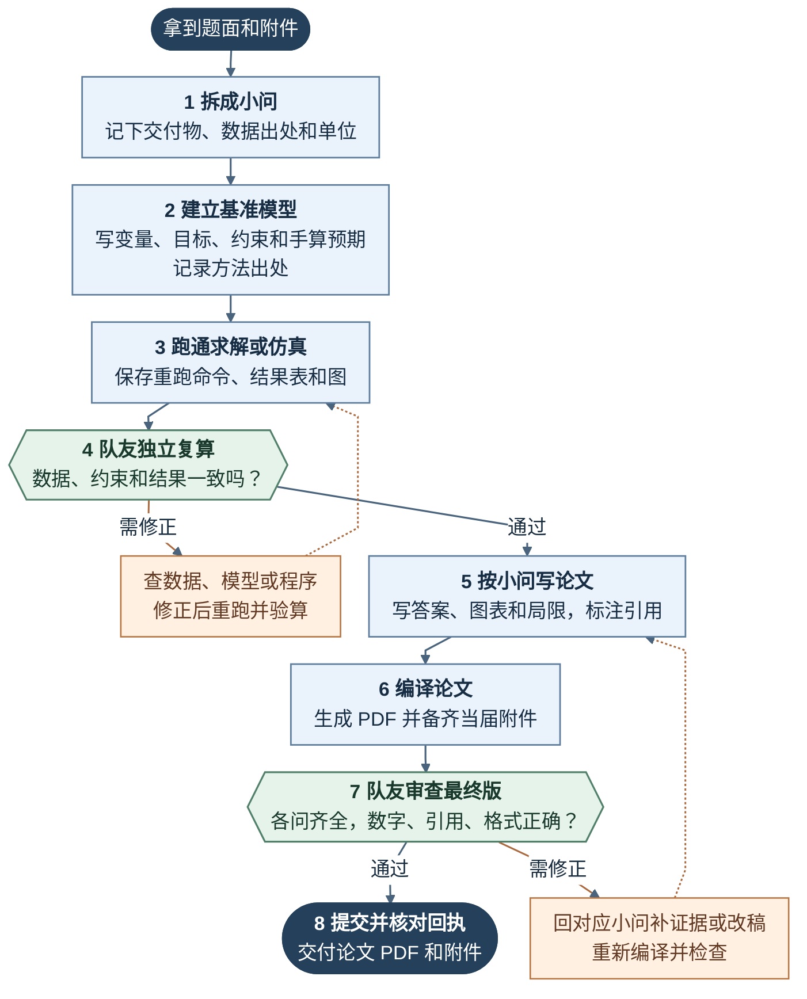

# 从赛题到可提交论文

拿到题面和附件后，从上往下走。每走完一格，就把该步产出的文件或记录交给队友，两次检查通过后再提交。返工支路标出了修完要重新执行的步骤。

第一步先在 `CASE.md` 给每问记下已知数据、要回答的问题和计划交付的结果。[小问交接模板](../templates/CASE.md)

参考文献从第 1–2 步就开始找。拆题记录数据来源，建模记录方法出处，第 5 步把引用放到正文用到它的地方，第 7 步对照原文和 PDF 核对。[参考文献怎么找、怎么用](../docs/references-guide.md)

## 卡在哪一步就用哪个 Skill

| 步骤 | 可以调用的入口 |
| --- | --- |
| 1–2 拆题和定基准 | [mcm-model-training](../.agents/skills/mcm-model-training/SKILL.md) |
| 3 求解或仿真、生成图 | [mcm-code-training](../.agents/skills/mcm-code-training/SKILL.md) · [mcm-simulation-training](../.agents/skills/mcm-simulation-training/SKILL.md) · [mcm-visualization-training](../.agents/skills/mcm-visualization-training/SKILL.md) |
| 4 和 7 验算或复核稿件 | [mcm-training-review](../.agents/skills/mcm-training-review/SKILL.md) |
| 5–6 写稿和编译 | [mcm-paper-training](../.agents/skills/mcm-paper-training/SKILL.md) |
| 8 核对文件与提交 | [首赛手册的交稿步骤](../docs/team-playbook.md#7-从干净目录复跑一次再提交) |

[首赛手册](../docs/team-playbook.md) · [Mermaid 源文件](first-contest-mindmap.mmd) · [图片版](first-contest-mindmap.png)
